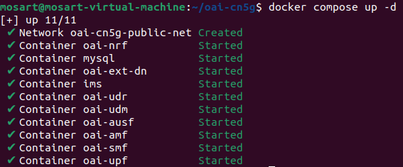
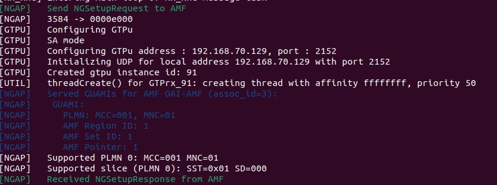
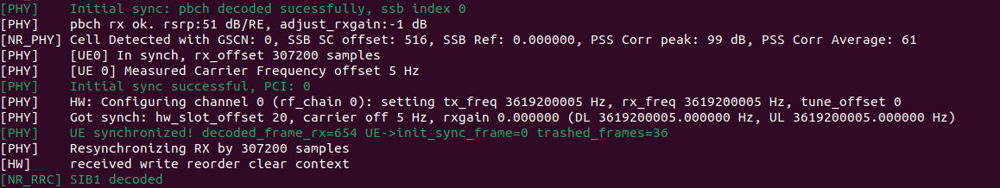
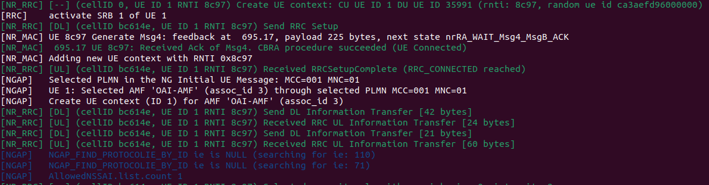
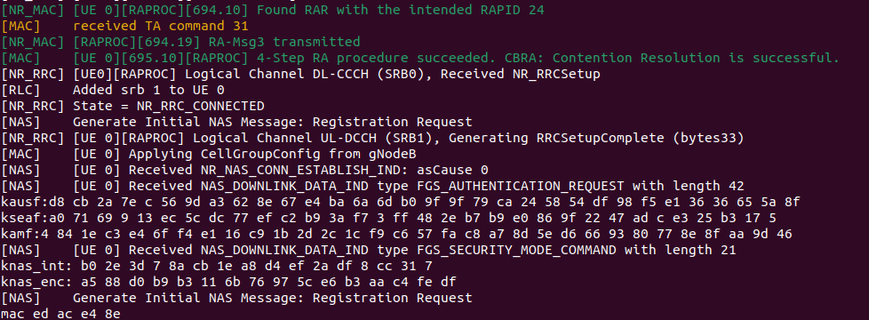
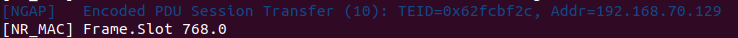
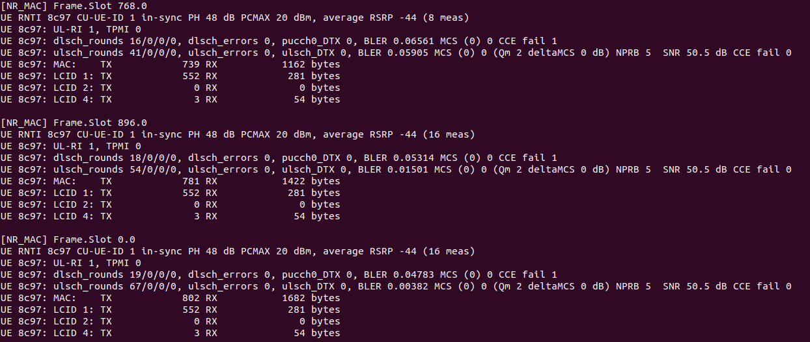
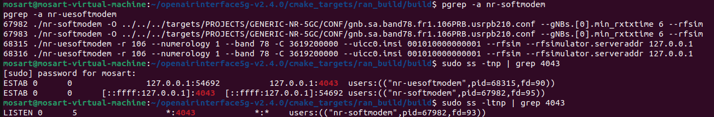
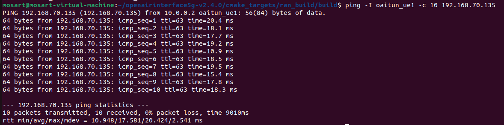
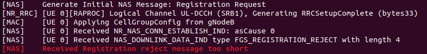

# Lab 3: Deploying a 5G Standalone Network Using OpenAirInterface

## 1. Goal

In the previous labs, you analyzed 5G signaling messages and network performance using provided captures and measurements.

In this lab, you will deploy your own 5G Standalone (SA) network using OpenAirInterface (OAI), verify the complete connection, investigate RFsimulator communication, perform active network measurements, and troubleshoot a controlled connection failure.

Unlike the previous labs, you will collect measurements directly from your own running 5G network.

**Learning Objectives**

After completing this lab, you should be able to:

1. Deploy an OAI gNB, nrUE, and 5G Core Network.
2. Identify the main stages of 5G SA connection establishment.
3. Verify communication between gNB and nrUE through RFsimulator.
4. Measure user-plane connectivity under different packet sizes.
5. Diagnose connection failures using OAI and 5GC logs.
6. Explain the limitations of a software-simulated 5G network.

## 2. Experimental Environment

Use the *OAI v2.4.0 Build Guide* to prepare the environment before class.

| Component          | Configuration   |
| ------------------ | --------------- |
| Ubuntu             | 24.04           |
| OAI RAN            | v2.4.0          |
| 5G Core            | OAI CN5G        |
| gNB                | nr-softmodem    |
| UE                 | nr-uesoftmodem  |
| Radio interface    | RFsimulator     |
| Band               | n78             |
| Subcarrier spacing | 30 kHz          |
| Resource blocks    | 106             |
| UE IMSI            | 001010000000001 |
| External DN        | 192.168.70.135  |

The experiment uses one Ubuntu machine without physical RF hardware.

## 3. Task 1 — Deploy and Verify the Complete 5G SA Network

Start the OAI CN5G:

```bash
cd ~/oai-cn5g
docker compose up -d
docker compose ps
```

Start the gNB and nrUE using the commands in the Build Guide.

Observe their terminal outputs and locate evidence of the following stages.

| Stage                        | Successful? | Evidence from logs                    |
| ---------------------------- | ----------- | ------------------------------------- |
| CN5G initialization          | yes         |          |
| gNB NG Setup                 | yes         |  |
| UE synchronization           | yes         |  |
| RRC connection establishment | yes         |  |
| UE Registration              | yes         |          |
| PDU Session Establishment    | yes         |          |
| UE tunnel creation           | yes         |  |

Take screenshots showing the gNB and UE successfully connected.

**Questions:**

1. Does a successful NG Setup guarantee that a UE can register? Explain.
   - Answer : No. NG Setup connects the gNB to the AMF; UE Registration separately requires valid credentials and successful authentication.
2. Why can the UE establish an RRC connection but still fail Registration?
   - Answer : RRC connects the UE to the gNB but does not authenticate it with the 5G Core. Registration can fail if the UE's identity or credentials are invalid.
3. What additional procedure is required after Registration before user data can be exchanged?
   - Answer : The UE must establish a PDU Session to set up its user-plane data path through the 5G Core.

## 4. Task 2 — Investigate RFsimulator Communication

OAI RFsimulator replaces the physical RF interface with software-based communication.

The gNB and nrUE exchange IQ samples through a TCP connection.

Check the running processes:

```bash
pgrep -a nr-softmodem
pgrep -a nr-uesoftmodem
```

Inspect the TCP connections:

```bash
sudo ss -tnp | grep 4043
```

If necessary, inspect the listener:

```bash
sudo ss -ltnp | grep 4043
```

The default RFsimulator port in this experiment is 4043.

Complete the table:

| Item                           | Observed Value                             |
| ------------------------------ | ------------------------------------------ |
| gNB process ID                 | 68315                                      |
| nrUE process ID                | 67982                                      |
| RFsimulator transport protocol | Tcp                                        |
| RFsimulator port               | 4043                                       |
| TCP connection state           | ESTAB                                      |
| Connected process(es)          | nr-softmodem (gNB) and nr-uesoftmodem (UE) |

Take one screenshot showing the TCP connection.

Screenshot
---


**Questions:**

1. Why does RFsimulator use a TCP connection instead of a physical antenna?
   - Answer : TCP carries simulated IQ samples between the gNB and UE, replacing the physical radio link.
2. Are the TCP packets exchanged by RFsimulator the same as the UE's application-layer IP packets?
   - Answer : No. RFsimulator TCP carries IQ samples; UE application data travels separately through the PDU Session and UPF.
3. Does using RFsimulator mean that the UE and gNB are performing no physical-layer processing? Explain.
   - Answer : No. The UE and gNB still perform physical-layer processing, such as modulation, coding, and OFDM; RFsimulator only replaces the radio hardware.

## 5. Task 3 — Verify End-to-End Connectivity

Check the UE tunnel interface:

```bash
ip -4 addr show oaitun_ue1
```

Test connectivity to the External DN:

```bash
ping -I oaitun_ue1 -c 10 192.168.70.135
```

Record:

| Measurement         | Observed Value |
| ------------------- | -------------- |
| UE IP address       | 10.0.0.2       |
| Destination IP      | 192.168.70.135 |
| Packets transmitted | 10             |
| Packets received    | 10             |
| Packet loss (%)     | 0              |
| Minimum RTT (ms)    | 10.948         |
| Average RTT (ms)    | 17.581         |
| Maximum RTT (ms)    | 20.424         |

Take a screenshot of the Ping result.

Screenshot
---


**Questions:**

1. Why must Ping use the `oaitun_ue1` interface in this experiment?
   - Answer : `oaitun_ue1` routes Ping through the UE's PDU Session and 5G user plane.
2. Does successful Registration guarantee successful user-plane connectivity?
   - Answer : No. User-plane connectivity also requires a working PDU Session and data path through the UPF.
3. What does a successful Ping prove, and what does it not prove about the simulated 5G system?
   - Answer : It proves that ICMP traffic can reach the destination and return through the user plane. It does not prove real-world RF performance or application throughput.

## 6. Task 4 — Investigate the Effect of Packet Size

You will now investigate whether changing the ICMP packet size affects the observed RTT.

Perform three experiments using the same established 5G connection.

**Scenario A — Small Packets**

```bash
ping -I oaitun_ue1 -s 56 -c 30 -i 0.2 192.168.70.135
```

**Scenario B — Medium Packets**

```bash
ping -I oaitun_ue1 -s 512 -c 30 -i 0.2 192.168.70.135
```

**Scenario C — Large Packets**

```bash
ping -I oaitun_ue1 -s 1200 -c 30 -i 0.2 192.168.70.135
```

Note: `-s` specifies ICMP payload size, not the complete IP packet size.

Complete the table:

| Scenario | ICMP Payload | Avg. RTT (ms) | Max. RTT (ms) | Packet Loss (%) |
| -------- | -----------: | ------------: | ------------: | --------------: |
| A        |     56 bytes |        17.413 |        19.018 |              0% |
| B        |    512 bytes |        18.767 |        20.283 |              0% |
| C        |   1200 bytes |        21.567 |        24.703 |              0% |

Calculate the RTT difference:

```text
RTT Difference = Average RTT(C) - Average RTT(A)
```

**Questions:**

1. Which scenario has the highest average RTT?
   - Answer : Scenario C (1200 bytes), at 21.567 ms.
2. Does increasing packet size always increase RTT in your measurements?
   - Answer : RTT increased in these tests: 17.413 ms (56 bytes), 18.767 ms (512 bytes), and 21.567 ms (1200 bytes). This trend is not guaranteed in every run.
3. Why might a larger packet require more transmission or processing resources?
   - Answer : Larger packets contain more bits to transmit and process, which can increase transmission time and workload. Packets exceeding the MTU may also require fragmentation.
4. What factors other than packet size could affect RTT in a software-based 5G network?
   - Answer : CPU load, software overhead, queueing, RFsimulator processing, and the 5G Core or external network path can also affect RTT.
5. Can these results be interpreted as real over-the-air 5G latency? Explain.
   - Answer : No. These measurements come from OAI/RFsimulator and do not include real radio hardware or over-the-air conditions. They describe this test setup, not real-world 5G latency.

Do not assume that RTT must increase with packet size. Use your measured values to support your explanation.

## 7. Task 5 — Diagnose a Controlled UE Registration Failure

In this task, you will deliberately introduce one configuration error and investigate why the UE cannot complete registration.

**Important:** Save the original successful UE command before starting. Do not modify the CN5G subscriber database.

### Step 1 — Stop the UE

Press `Ctrl+C` in the nrUE terminal. Keep the CN5G and gNB running.

### Step 2 — Launch the UE with an Incorrect IMSI

Change only the IMSI:

```bash
sudo ./nr-uesoftmodem \
  -r 106 \
  --numerology 1 \
  --band 78 \
  -C 3619200000 \
  --uicc0.imsi 001010000000099 \
  --rfsim \
  --rfsimulator.serveraddr 127.0.0.1
```

The IMSI `001010000000099` is not provisioned in the standard classroom subscriber configuration. Verify this assumption against the instructor's database before class.

Observe the UE and AMF logs.

```bash
cd ~/oai-cn5g
docker compose logs --since=2m oai-amf
```

Allow time for registration attempts, then stop the UE.

Complete the table:

| Item                        | Observation                                                           |
| --------------------------- | --------------------------------------------------------------------- |
| Modified parameter          | imsi                                                                  |
| UE synchronized with gNB?   | yes                                                                   |
| RRC connection established? | yes — the UE log shows `Generating RRCSetupComplete`                  |
| Registration successful?    | no                                                                    |
| Error or rejection evidence | UE log shows `Registration reject` |
| Likely cause                | The modified IMSI is not registered in the subscriber database.       |

If the expected registration rejection does not appear, report the actual logs instead of inventing a failure message.

### Step 3 — Restore the Original IMSI

Restart the nrUE using:

```text
--uicc0.imsi 001010000000001
```

Confirm that the UE successfully registers again and that Ping works.

**Questions:**

1. Why can the UE potentially synchronize with the gNB even when the IMSI is incorrect?
   - Answer : Synchronization and RRC setup are radio procedures and do not validate the IMSI. The 5G Core checks the IMSI later during Registration and authentication.
2. Which network function is involved in UE authentication?
   - Answer : The AMF coordinates authentication with the AUSF, which uses subscriber data from the UDM. An unknown IMSI can cause authentication and Registration to fail.
3. Why does changing an IMSI affect Registration but not the RFsimulator TCP connection itself?
   - Answer : The IMSI is checked by the 5G Core during NAS Registration. RFsimulator TCP only carries radio samples between the gNB and UE, so it can remain connected even if Registration fails.
4. What evidence proves that restoring the correct configuration solved the problem?
   - Answer : With the original IMSI (`001010000000001`), UE/AMF logs should show successful Registration. Successful PDU Session establishment and Ping through `oaitun_ue1` further confirm recovery; include evidence from both the failed and recovered runs.

Submit evidence from both the failed and recovered connections.


## 8. Task 7 — Explain the Relationship Between Simulation and Real 5G

Your OAI gNB and nrUE perform 5G NR protocol processing even though they do not use physical antennas.

Complete the comparison:

| Feature                      | OAI RFsimulator                                              | Physical 5G System                        |
| ---------------------------- | ------------------------------------------------------------ | ----------------------------------------- |
| gNB and UE protocol stack    | OAI software stack                                           | gNB and physical UE stack                 |
| OFDM signal processing       | Processed in software; IQ samples pass through the simulator | Processed by gNB and UE radio systems     |
| Physical antennas            | Not used                                                     | Used for radio transmission and reception |
| RF hardware impairments      | Not included by default                                      | Present in radio hardware                 |
| Wireless propagation effects | Not included unless simulated                                | Present over the air                      |
| 5G Core connectivity         | Connects to a 5G Core, e.g. OAI CN5G                         | Connects to a compatible 5G Core          |

**Questions:**

1. Which parts of the 5G system remain functional when physical RF hardware is replaced with RFsimulator?
   - Answer : The OAI gNB and UE protocol stacks, NR processing, and RRC/NAS signaling still work and can communicate with the 5G Core. RFsimulator replaces the radio link with a software connection.
2. Why is RFsimulator useful for testing the 5G protocol stack?
   - Answer : It lets developers test gNB/UE software and 5G procedures without radio hardware, in a controlled and repeatable environment.
3. Why might latency and throughput differ between RFsimulator and a real 5G deployment?
   - Answer : RFsimulator measurements are affected by host CPU load and software overhead. Real 5G also has radio hardware limits and over-the-air effects such as fading and interference, so simulated latency and throughput may differ.
4. What would need to change if you wanted to test a physical UE instead of OAI nrUE?
   - Answer : Use a gNB with compatible RF hardware and antennas, and configure its radio settings for the physical UE. The UE also needs a provisioned USIM and matching subscriber settings in the 5G Core.

## 9. Final Analysis

Answer each question in three to five sentences.

1. Describe the complete process from starting the OAI 5GC to successful user-plane connectivity.
   - Answer : Start the OAI 5G Core and gNB, then verify NG Setup with the AMF. Start the nrUE and confirm synchronization, RRC connection, and successful Registration. Establish a PDU Session, then Ping through `oaitun_ue1` to verify user-plane connectivity.
2. Explain the difference between an RFsimulator TCP connection and a 5G PDU Session.
   - Answer : RFsimulator TCP carries simulated IQ samples between the gNB and nrUE; it is not UE application traffic. A PDU Session provides the UE's user-data path through the 5G Core and UPF. The TCP link may work even if Registration or PDU Session setup fails.
3. Based on your measurements, how did packet size affect RTT and packet loss?
   - Answer : Average RTT rose from 17.413 ms (56 bytes) to 18.767 ms (512 bytes) and 21.567 ms (1200 bytes). The increase from the smallest to largest payload was 4.154 ms. Packet loss was 0% in all scenarios.
4. Describe the registration failure you introduced and explain how you diagnosed and recovered from it.
   - Answer : I changed the IMSI to the unprovisioned `001010000000099`; the UE synchronized and completed RRC setup, but Registration failed. Its log showed a Registration Reject, while AMF logs are needed to confirm the exact cause. Restoring `001010000000001` should restore service, confirmed by successful Registration, PDU Session setup, and Ping through `oaitun_ue1`.
5. Identify two limitations of this simulated environment and explain how they might affect experimental results.
   - Answer : RFsimulator lacks real radio propagation and hardware effects by default, so results do not capture real-world fading, interference, or RF noise. Also, the gNB, UE, and Core share a host, where CPU load and software overhead can affect RTT and throughput. Therefore, results may not represent performance over a physical 5G network.

## 10. Submission Checklist

Submit one Markdown or PDF report containing:

- Completed 5G SA connection verification table.
- gNB and nrUE connection screenshots.
- RFsimulator TCP connection evidence.
- Baseline Ping measurement.
- Three packet-size comparison results.
- RTT difference calculation.
- Controlled failure and recovery evidence.
- RFsimulator versus physical 5G comparison.
- Answers to the final analysis questions.

All measurements and log evidence must come from your own experimental environment.

## 11. Grading Rubric

| Item                                      |  Points |
| ----------------------------------------- | ------: |
| Complete 5G SA deployment                 |      15 |
| RFsimulator TCP connection analysis       |      15 |
| End-to-end user-plane verification        |      15 |
| Packet-size experiment and analysis       |      20 |
| Controlled failure and recovery           |      20 |
| Simulation limitations and final analysis |      15 |
| **Total**                                 | **100** |

Vote TOP3：https://forms.gle/Mvza68DFBzPcZXfW6