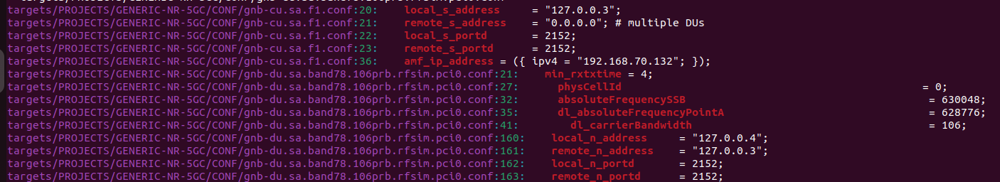
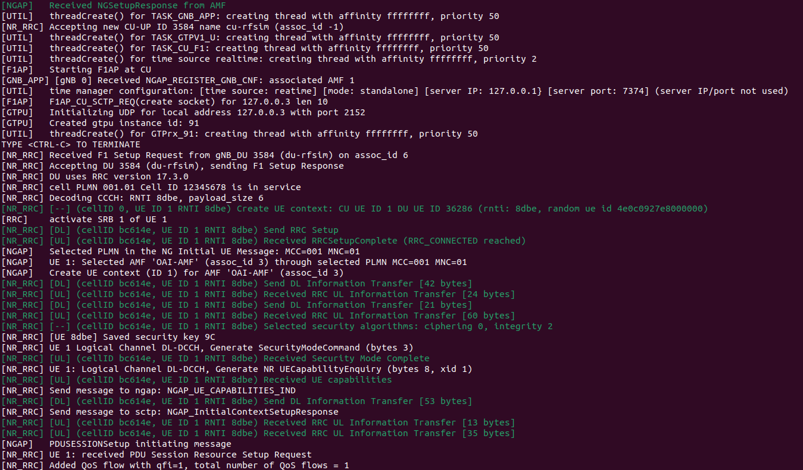
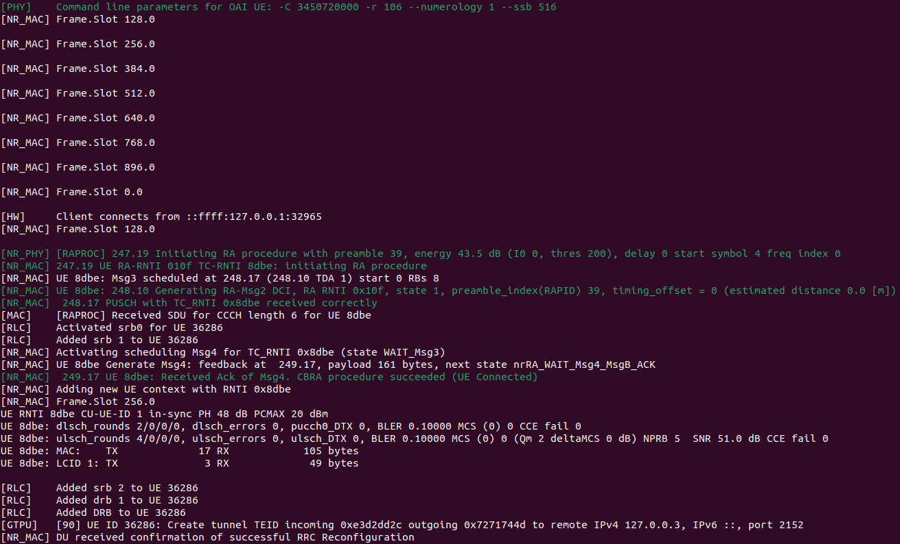
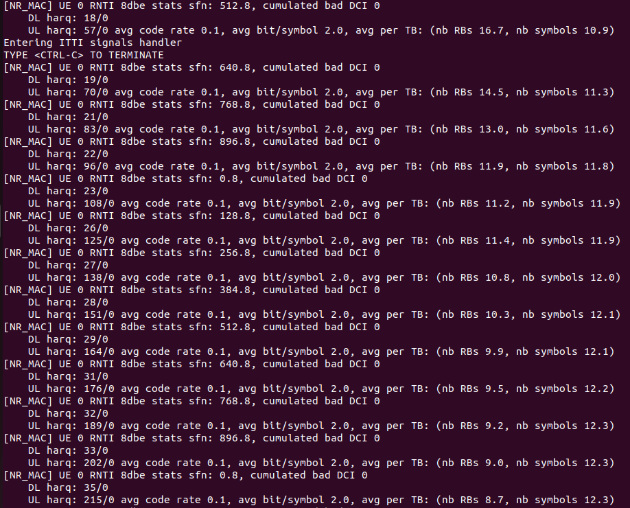
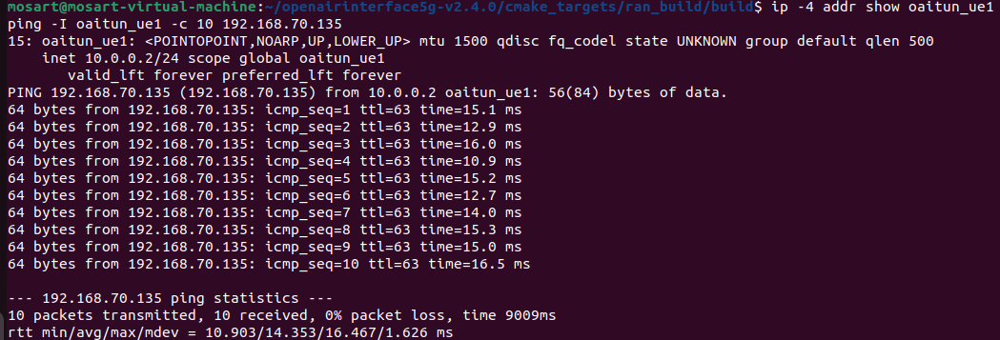
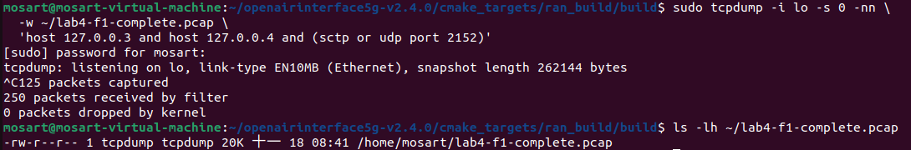
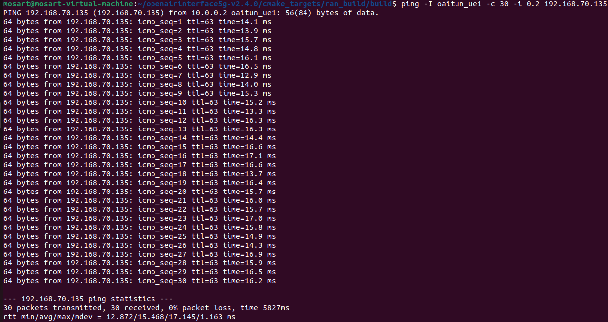
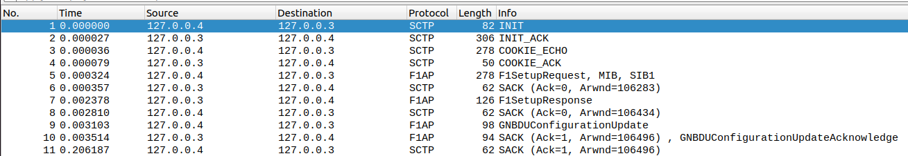
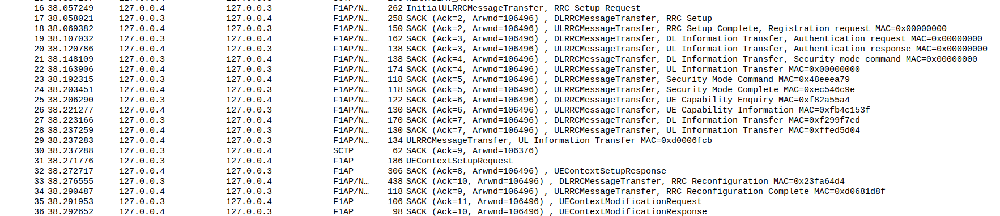
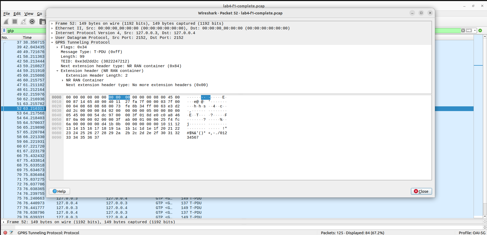

# Lab 4 — 5G CU/DU Split Deployment and F1-C/F1-U Analysis

**Student handout**  
**Environment:** Ubuntu 24.04 LTS · OpenAirInterface (OAI) v2.4.0 · RFsimulator · no SDR required  
**Prerequisite:** Lab 3 completed successfully (OAI CN5G, gNB, nrUE, UE tunnel and Ping)

> **Lab objective:** Replace the monolithic gNB from Lab 3 with a split gNB-CU and gNB-DU. Capture and analyze both **F1-C** (F1AP over SCTP) and **F1-U** (GTP-U over UDP) in a single PCAP file. Verify that the UE can still establish a PDU session and reach the external data network.
>
> **Instructor validation:** This lab's CU/DU split, F1 Setup, UE RRC signaling, UE Context procedures, GTP-U T-PDUs, and external-DN Ping were observed on the classroom OAI v2.4.0 environment. Exact IP addresses, frequencies and core network configuration must be checked on each student image.

---

## 1. Learning objectives

After completing this lab, you should be able to:

1. Explain the functional division between gNB-CU and gNB-DU.
2. Deploy a split 5G SA RAN with OAI and RFsimulator.
3. Identify **F1-C** control-plane messages (F1 Setup, RRC transfer, UE Context Setup).
4. Identify **F1-U** user-plane GTP-U packets, including their direction and TEID.
5. Verify UE IP connectivity through the split architecture.
6. Distinguish F1-U from the separate **N3** interface, even though both can use GTP-U.

## 2. Network architecture and experimental parameters

```text
                         OAI 5G Core
                     AMF / SMF / UPF
                           |
                   N2 (NGAP) / N3 (GTP-U)
                           |
                      +----------+
                      |  gNB-CU  |  F1-C IP: 127.0.0.3
                      | RRC/PDCP |  (example classroom setup)
                      +----------+
                         |     |
        F1-C: F1AP/SCTP |     | F1-U: GTP-U/UDP
                         |     |
                      +----------+
                      |  gNB-DU  |  F1 IP: 127.0.0.4
                      |RLC/MAC/PHY|
                      +----------+
                           |
                    RFsimulator (IQ/TCP)
                           |
                         nrUE
                           |
                      oaitun_ue1
                           |
                       ICMP Ping
```

| Parameter | Classroom configuration |
|---|---|
| OAI version | `v2.4.0` |
| RAN | One gNB-CU + one gNB-DU + one nrUE |
| Radio | RFsimulator, no physical SDR |
| NR band | n78 |
| Bandwidth | 106 PRBs |
| Numerology | 1 (30 kHz SCS) |
| CU F1 address (observed) | `127.0.0.3` |
| DU F1 address (observed) | `127.0.0.4` |
| DU SSB NR-ARFCN (observed) | `630048` (3,450.72 MHz) |
| UE frequency argument used in successful split test | `-C 3450720000` |
| UE IMSI | `001010000000001` |
| External DN | `192.168.70.135` |

**Important:** The Lab 3 monolithic gNB config used `absoluteFrequencySSB = 641280` (3,619.20 MHz), whereas the split DU config used `630048` (3,450.72 MHz). The frequency parameters **must match the working DU/UE pair**. Do not reuse Lab 3's `-C 3619200000` without checking the DU configuration. The `-C` argument and effective radio carrier placement should be verified against OAI startup logs; the above value is the one used in the successful classroom test, not a general formula for every DU file.

---

## 3. Task 1 — Inspect the split configurations

### Step 1. Confirm the configuration files exist

```bash
cd ~/openairinterface5g-v2.4.0

ls -l \
  targets/PROJECTS/GENERIC-NR-5GC/CONF/gnb-cu.sa.f1.conf \
  targets/PROJECTS/GENERIC-NR-5GC/CONF/gnb-du.sa.band78.106prb.rfsim.pci0.conf
```

### Step 2. Check frequency and F1 network settings

```bash
grep -nE \
'absoluteFrequencySSB|dl_absoluteFrequencyPointA|dl_carrierBandwidth|physCellId|min_rxtxtime|local_s_address|remote_s_address|local_n_address|remote_n_address|local_s_portd|remote_s_portd|local_n_portd|remote_n_portd|amf_ip_address' \
  targets/PROJECTS/GENERIC-NR-5GC/CONF/gnb-cu.sa.f1.conf \
  targets/PROJECTS/GENERIC-NR-5GC/CONF/gnb-du.sa.band78.106prb.rfsim.pci0.conf
```

**Record:** The CU and DU F1 addresses, the DU SSB frequency, and PRB count. If the local settings differ from the table above, adapt the following commands and capture filters accordingly.

Screenshot
---


**Questions**

1. Which protocol layers mainly reside in the CU, and which reside in the DU?
     - Answer : The CU mainly contains RRC and PDCP, while the DU contains RLC, MAC and PHY.
2. What is the purpose of the F1 interface?
     - Answer : The F1 interface connects the CU and DU; F1-C carries control signaling and F1-U carries user-plane data.
3. Why must the UE radio frequency be compatible with the DU rather than taken blindly from the previous lab?
     - Answer : The UE and DU must use the same RF channel for synchronization, and different configurations may use different frequencies.

---

## 4. Task 2 — Deploy the split 5G SA network

Before starting, stop the monolithic Lab 3 gNB and any old nrUE processes with `Ctrl+C`. Avoid running two gNB/DU RFsimulator servers on the same listening port.

### Terminal 1 — Start CN5G

```bash
cd ~/oai-cn5g
docker compose up -d
docker compose ps
```

### Terminal 2 — Start gNB-CU

```bash
cd ~/openairinterface5g-v2.4.0/cmake_targets/ran_build/build

sudo ./nr-softmodem \
  -O ../../../targets/PROJECTS/GENERIC-NR-5GC/CONF/gnb-cu.sa.f1.conf
```

### Terminal 3 — Start gNB-DU

**Start the packet capture in Task 3 *before* starting the DU if you want to record the initial F1 Setup handshake.**

```bash
cd ~/openairinterface5g-v2.4.0/cmake_targets/ran_build/build

sudo ./nr-softmodem \
  -O ../../../targets/PROJECTS/GENERIC-NR-5GC/CONF/gnb-du.sa.band78.106prb.rfsim.pci0.conf \
  --rfsim
```

### Terminal 4 — Start nrUE

```bash
cd ~/openairinterface5g-v2.4.0/cmake_targets/ran_build/build

sudo ./nr-uesoftmodem \
  -r 106 \
  --numerology 1 \
  --band 78 \
  -C 3450720000 \
  --uicc0.imsi 001010000000001 \
  --rfsim \
  --rfsimulator.serveraddr 127.0.0.1
```

> **Instructor note:** This UE command reflects the working classroom split configuration. In particular, the original Lab 3 `-C 3619200000` setting was not compatible with this DU configuration. If a provided classroom image has different NR frequencies or UICC credentials, use the instructor-validated values.

### Check the UE connection

```bash
ip -4 addr show oaitun_ue1
ping -I oaitun_ue1 -c 10 192.168.70.135
```

**Evidence:** Screenshots of CU/DU startup, UE connection, and successful Ping. Record the observed UE IP, transmitted/received packets, packet loss, and average RTT. Do **not** invent values; they vary by machine.

Screenshot
---
CU


DU


UE


Ping

---

## 5. Task 3 — Capture F1-C and F1-U in a single PCAP

The classroom capture showed CU `127.0.0.3` and DU `127.0.0.4` on the Linux loopback interface (`lo`).

### Step 1. Start packet capture

Start CN5G and CU, but **before starting the DU** open another terminal:

```bash
sudo tcpdump -i lo -s 0 -nn \
  -w ~/lab4-f1-complete.pcap \
  'host 127.0.0.3 and host 127.0.0.4 and (sctp or udp port 2152)'
```

This captures:

- **F1-C:** F1AP carried over SCTP.
- **F1-U:** GTP-U carried over UDP port 2152, **provided the configured F1-U endpoints and port match these values**.

### Step 2. Trigger control-plane and user-plane traffic

1. Start the DU to trigger **SCTP association** and **F1 Setup**.
2. Start nrUE to trigger **RRC** and **UE Context** procedures.
3. After the UE tunnel appears, generate traffic:

```bash
ping -I oaitun_ue1 -c 30 -i 0.2 192.168.70.135
```

4. Press `Ctrl+C` in the **tcpdump terminal** to finish and save the PCAP.
5. Verify the file:

```bash
ls -lh ~/lab4-f1-complete.pcap
```

### Alternative: capture all traffic between CU and DU

If you are unsure of the F1-U UDP port, use this **instead of** the filtered capture above:

```bash
sudo tcpdump -i lo -s 0 -nn \
  -w ~/lab4-f1-all.pcap \
  'host 127.0.0.3 and host 127.0.0.4'
```

If the CU and DU are not communicating over `lo`, select the correct interface (`ip -br addr` or `tcpdump -D`) and update the IP filter.

Screenshot
---



---

## 6. Task 4 — Analyze F1-C (F1AP / SCTP)

Open the capture:

```bash
wireshark ~/lab4-f1-complete.pcap
```

Useful **Wireshark display filters**:

```text
sctp
f1ap
```

Find and record these messages:

| Message | Typical direction | Meaning |
|---|---|---|
| SCTP INIT / INIT_ACK / COOKIE_ECHO / COOKIE_ACK | DU ↔ CU | Establish SCTP association |
| F1 Setup Request | DU → CU | DU initiates F1 connection and provides served-cell information |
| F1 Setup Response | CU → DU | CU accepts F1 Setup |
| GNBDUConfigurationUpdate | DU → CU | DU informs CU of configuration changes |
| Initial UL RRC Message Transfer (RRC Setup Request) | DU → CU | UE initial RRC request forwarded to CU |
| DL RRC Message Transfer (RRC Setup) | CU → DU | CU delivers RRC Setup toward UE |
| UL RRC Message Transfer (RRC Setup Complete) | DU → CU | UE completes RRC procedure; NAS Registration Request can be carried inside |
| UE Context Setup Request / Response | CU ↔ DU | Establish UE-specific resources/context |
| DL RRC Message Transfer (RRC Reconfiguration) | CU → DU | CU sends further RRC configuration |

**Observed classroom sequence:** The successful capture contained SCTP association, F1 Setup Request/Response, DU Configuration Update/Acknowledgement, RRC Setup messages, Authentication signaling carried through RRC, UE Context Setup/Modification, and RRC Reconfiguration. The exact packet numbers and timing are **not fixed**.


**Questions**

1. Which node initiates F1 Setup, and which acknowledges it?
     - Answer : The DU initiates F1 Setup by sending F1 Setup Request to the CU, and the CU acknowledges it with F1 Setup Response.
2. Explain the difference between SCTP association establishment and F1 Setup.
     - Answer : SCTP association establishes the transport connection between CU and DU, while F1 Setup exchanges F1 application-level capability and configuration information.
3. How can a NAS Registration Request be transported over F1-C?
     - Answer : The DU forwards the UE's NAS Registration Request inside an F1AP RRC message to the CU, which then relays it toward the 5G Core.
4. What is the role of UE Context Setup?
     - Answer : UE Context Setup creates the UE-specific RAN context and resources in the DU after the CU requests it.
5. Does F1 Setup alone prove successful UE Registration? Explain.
     - Answer : No. F1 Setup only establishes the DU-CU connection and F1 interface; UE Registration requires successful NAS authentication and core-network registration procedures.

**Evidence:** Screenshot with F1 Setup Request/Response and screenshot with at least three UE-associated F1AP messages. Include packet numbers and source/destination addresses.

Screenshot
---
F1 setup Request/Response



F1AP message


---

## 7. Task 5 — Analyze F1-U (GTP-U / UDP)

In the **same PCAP**, apply:

```text
gtp
```

If necessary, first check:

```text
udp.port == 2152
```

Directional display filters (based on the observed classroom CU/DU IP pair):

```text
gtp && ip.src == 127.0.0.4 && ip.dst == 127.0.0.3
gtp && ip.src == 127.0.0.3 && ip.dst == 127.0.0.4
```

In the captured GTP-U packet details, inspect:

```text
Internet Protocol (outer CU/DU addresses)
  User Datagram Protocol
    GPRS Tunneling Protocol (GTP-U)
      Message Type: G-PDU / T-PDU
      Tunnel Endpoint Identifier (TEID)
      Encapsulated user payload (if decodable)
```

**Important:** The classroom trace showed repeated `GTP T-PDU` packets from `127.0.0.4` (DU) to `127.0.0.3` (CU), confirming traffic on the CU–DU user-plane path. The actual TEID was **not recorded** in the provided screenshot: read the TEID from your own packet details instead of assuming a value.

### Distinguish F1-U from N3

Both **F1-U** and **N3** can use GTP-U. Do **not** classify traffic as F1-U solely because Wireshark says `GTP` or the port is `2152`.

- **F1-U:** GTP-U between **gNB-DU and gNB-CU**.
- **N3:** GTP-U between **gNB-CU and 5GC UPF**.

Identify the interface using the actual source/destination endpoints and configuration.

**Questions**

1. Which transport protocol carries F1-U?
     - Answer : UDP, carrying GTP-U.
2. What does a GTP-U **TEID** identify?
    - Answer : 0xe3d2dd2c
3. Which direction is `127.0.0.4 → 127.0.0.3` in this setup?
     - Answer : DU to CU
4. How would you distinguish F1-U from N3 in a packet capture?
     - Answer : F1-U is GTP-U between the DU and CU, while N3 is GTP-U between the CU and UPF.
5. Why do F1-C and F1-U use different transport protocols?
     - Answer : F1-C carries control signaling and uses reliable SCTP, while F1-U carries user-plane data and uses lightweight UDP with GTP-U.

**Evidence:** Screenshot of at least one GTP-U T-PDU, with outer IP addresses, UDP ports, message type, and TEID visible. Record the observed UL and DL packet counts (if both directions are present). Do not assume equal counts.

Screenshot
---



| Direction | Source | Destination | Packet Count |
|---|---|---|---:|
| DL | CU 127.0.0.3 | DU 127.0.0.4 | 40 |
| UL | DU 127.0.0.4 | CU 127.0.0.3 | 44 |

---

## 8. Task 6 — Compare monolithic and split gNB

Complete the table:

| Feature | Lab 3: Monolithic gNB | Lab 4: CU/DU Split |
|---|---|---|
| Number of RAN processes | 1 | 2 |
| Location of RRC/PDCP | gNB | CU |
| Location of RLC/MAC/PHY | gNB | DU |
| F1-C interface present? | no | yes |
| F1-U interface present? | no | yes |
| UE connected to the same 5GC? | yes | yes |
| End-to-end Ping works? | yes | yes|

Explain in **3–5 sentences** why splitting a gNB changes the internal RAN interfaces but does not change the UE's need for synchronization, registration and a PDU session.

- Answer : Splitting a gNB separates RAN functions among different units, changing the internal interfaces. It does not change the core functions required by the UE. The UE still needs synchronization, registration, and a PDU session for network communication.
---

## 9. Troubleshooting

| Symptom | First checks |
|---|---|
| DU cannot establish F1 Setup | CU running; CU/DU F1 IP and ports; SCTP association; `f1ap` capture |
| UE repeatedly fails to decode SIB1 | Verify DU `absoluteFrequencySSB` and UE `-C`; check PHY/MAC synchronization and DU logs |
| UE syncs but Registration fails | Check CU/AMF logs, subscriber credentials (IMSI/key/OPc), RRC/NAS progress |
| UE attaches but no `oaitun_ue1` | Check PDU Session Establishment, 5GC SMF/UPF and UE logs |
| Ping fails | Confirm the tunnel, external DN reachability, routing, and user-plane path |
| Only F1AP appears in PCAP | Run Ping; verify PDU session; verify F1-U endpoints/port and capture interface |
| GTP appears but could be N3 | Check source/destination IPs against DU, CU and UPF addresses |
| Wireshark does not decode UDP 2152 as GTP-U | Examine UDP payload and optionally use **Analyze → Decode As…** |

**Do not** assume a screenshot of F1 Setup proves that UE Registration and end-to-end connectivity have succeeded. Validate each stage separately.

---

## 10. Submission checklist

Submit **one Markdown or PDF report** and **one PCAP file** containing:

- [ ] CU/DU configuration summary and frequency check.
- [ ] CU/DU and nrUE running evidence.
- [ ] UE tunnel IP and successful Ping result (loss and RTT).
- [ ] One PCAP containing **F1-C and F1-U**.
- [ ] F1 Setup Request/Response screenshot.
- [ ] Three or more UE-related F1AP messages with explanation.
- [ ] At least one GTP-U T-PDU screenshot with TEID and endpoints.
- [ ] Explanation distinguishing F1-C, F1-U and N3.
- [ ] Completed monolithic-vs-split comparison table.
- [ ] Answers to all analysis questions.

All screenshots, packet numbers, TEIDs and measurements must come from **your own experiment**.

## 11. Suggested grading rubric

| Category | Points |
|---|---:|
| Correct CU/DU deployment and parameter verification | 20 |
| F1-C capture and F1 Setup analysis | 20 |
| RRC/UE Context messages over F1-C | 20 |
| F1-U GTP-U and TEID analysis | 20 |
| UE tunnel and end-to-end Ping | 10 |
| Monolithic vs split comparison and report quality | 10 |
| **Total** | **100** |

---

## 12. Stop the experiment

Stop nrUE, DU and CU with `Ctrl+C`. Then stop CN5G:

```bash
cd ~/oai-cn5g
docker compose down
```

**Takeaway:** In the same OAI 5G SA network, **F1-C** exchanges RAN control signaling between CU and DU using **F1AP/SCTP**, while **F1-U** transports UE user-plane data between CU and DU using **GTP-U/UDP**. A successful UE Ping validates the end-to-end data path, while the PCAP shows what happens on the internal split-RAN interface.